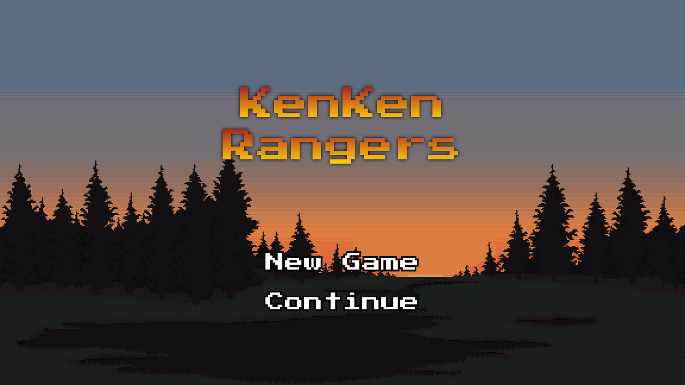

# KenKenRangers

A JavaFX puzzle game that combines KenKen arithmetic grids with a fantasy adventure. Solve number cages, survive enemy attacks, and use power-ups while progressing through the Rangers' Saga or playing other puzzle modes.

## Screenshot



The main menu is captured from the application's JavaFX scene. Gameplay requires the native JavaFX media/audio stack in addition to the graphical interface.

## Features

- Generated KenKen grids with arithmetic cage targets and no repeated numbers in a row or column.
- An interactive tutorial explaining puzzle rules and game mechanics.
- A six-chapter **Rangers' Saga** with progression and high scores.
- **Bottomless Abyss** and a configurable **Custom Trial** mode.
- Custom trial grids from 3×3 to 6×6, adjustable damage over time, and selectable power-up quantities.
- **Power Surge**, **Invincibility**, and **Cell Reveal** power-ups.
- Player profiles, saved progression, and high scores stored in SQLite.
- Pixel-art scenes, bundled fonts, sound effects, and background music.

## Requirements

- JDK **21 or newer** and Maven **3.9.x**. The project compiles for Java 21; compilation was verified with Java 25 and Maven 3.9.11.
- A graphical desktop with JavaFX-compatible native graphics and media/audio libraries.
- Internet access for the initial Maven dependency download.

Maven supplies JavaFX 23.0.1, SQLite JDBC 3.49.1.0, and the required build plugins from `pom.xml`; a separate JavaFX SDK installation is not needed.

The current save-path implementation expects the Windows `LOCALAPPDATA` environment variable. Windows is the default environment for that path. On Linux or macOS, explicitly set a writable `LOCALAPPDATA` directory before using profiles or gameplay, and ensure the native JavaFX media stack is available.

## Installation

```bash
git clone https://github.com/LedgeA/KenKenRangers.git
cd KenKenRangers
mvn dependency:go-offline
```

If using the Maven copy already downloaded into this project on Linux, replace `mvn` with:

```bash
.dependencies/apache-maven-3.9.11/bin/mvn -Dmaven.repo.local="$PWD/.dependencies/m2" dependency:go-offline
```

## Usage

On Windows, launch from the repository root:

```powershell
mvn javafx:run
```

On Linux or macOS, provide the save directory first:

```bash
export LOCALAPPDATA="$PWD/.local-data"
mvn javafx:run
```

For the existing project-local Maven installation on Linux:

```bash
export LOCALAPPDATA="$PWD/.dependencies/app-data"
.dependencies/apache-maven-3.9.11/bin/mvn -Dmaven.repo.local="$PWD/.dependencies/m2" javafx:run
```

1. Choose **New Game**, enter a player name, and proceed to the tutorial.
2. Click through the tutorial instructions to learn the puzzle and combat rules.
3. Select a cell and type a number from `1` to the grid dimension.
4. Match each cage's target using its displayed arithmetic operation, without repeating numbers in any row or column.
5. Use the available power-up icons as needed and complete puzzles before enemy damage defeats you.

Choose **Continue** to select an existing player. The mode menu provides **Rangers' Saga**, **Bottomless Abyss**, **Custom Trial**, and the tutorial. Custom Trial lets you adjust grid size, damage over time, and each power-up count before starting.

The application launches fullscreen. Press **F11** to leave fullscreen mode.
